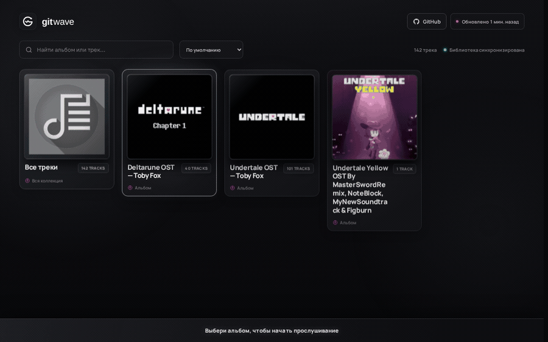

### Персональный музыкальный плеер

[**Открыть GitWave ↗**](https://gamooda.github.io/gitwave/) · [Исходный код](https://github.com/gamooda/gitwave)

  

## О проекте

GitWave — музыкальный веб-плеер для личной коллекции. Альбомы и композиции собраны в одной библиотеке: можно искать музыку, слушать отдельные альбомы или всю коллекцию, перемешивать треки и управлять воспроизведением.

Открой альбом, чтобы посмотреть список композиций. Кнопка **«Скачать ZIP»** откроет системное окно **«Сохранить как…»**. Выбери место и имя ZIP-файла. В разделе **«Все треки»** можно сохранить всю коллекцию одним архивом.

  

## Как пользоваться

Выбери альбом или открой **«Все треки»**. Нажми на композицию либо кнопку **«Слушать»**. Для быстрого перехода используй поиск, а для скачивания альбома или всей коллекции — **«Скачать ZIP»** в верхней части плейлиста.

## Управление

| Действие | Клавиша или кнопка |
|:--|:--|
| Воспроизведение и пауза | **Пробел** |
| Перемотка на 5 секунд | **← / →** |
| Закрыть альбом | **Esc** |
| Следующий или предыдущий трек | Кнопки плеера |
| Громкость, повтор и перемешивание | Нижняя панель |

[**Слушать музыку в GitWave ↗**](https://gamooda.github.io/gitwave/)

