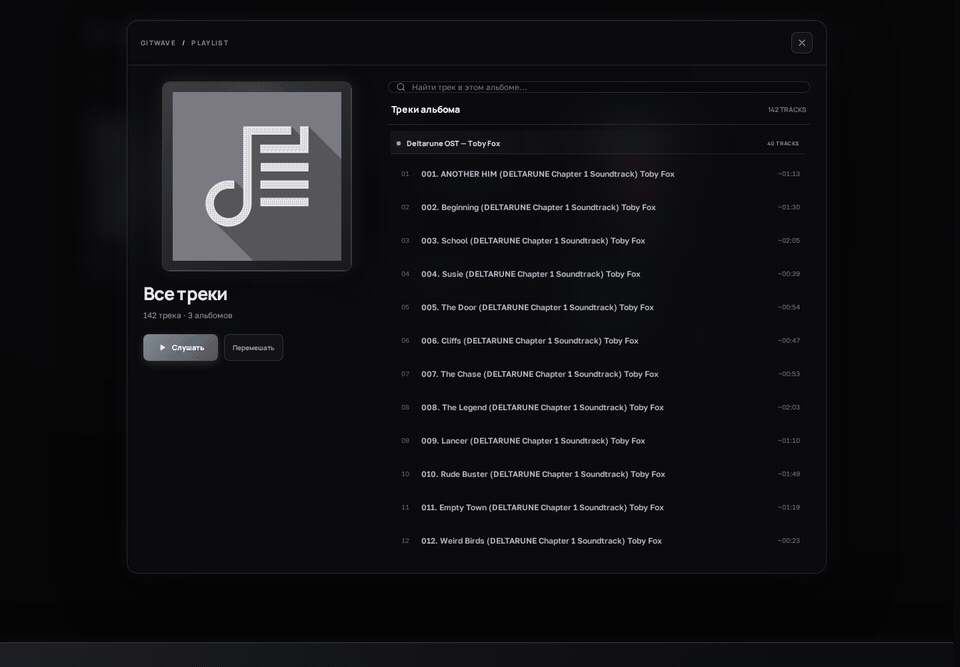

### Персональный музыкальный плеер

[**Открыть GitWave ↗**](https://gamooda.github.io/gitwave/) · [Исходный код](https://github.com/gamooda/gitwave)

  

## О проекте

GitWave — музыкальный веб-плеер для личной коллекции. Альбомы и композиции собраны в одной библиотеке: можно искать музыку, слушать отдельные треки или всю коллекцию, перемешивать композиции и управлять воспроизведением.

## Скачивание

- **Скачать ZIP** — передаёт готовый архив в загрузки браузера. Chrome и Edge показывают его в штатном списке загрузок.
- **Скачать трек** — отдельная кнопка у каждой композиции отправляет MP3, OGG или WAV в загрузки браузера.
- **ZIP выбранных** — позволяет отметить треки из разных альбомов и скачать их одним архивом.

Во время подготовки архива GitWave показывает количество файлов, объём, процент выполнения, скорость и примерное оставшееся время. Браузерная загрузка начинается потоком: ZIP не собирается целиком в одном большом Blob.

  

## Как пользоваться

Выбери альбом или открой **«Все треки»**. Нажми на композицию либо кнопку **«Слушать»**. Для быстрого поиска используй строку поиска. Для скачивания альбома нажми **«Скачать ZIP»**.

## Управление

| Действие | Клавиша или кнопка |
|:--|:--|
| Воспроизведение и пауза | **Пробел** |
| Перемотка на 5 секунд | **← / →** |
| Закрыть альбом | **Esc** |
| Следующий или предыдущий трек | Кнопки плеера |
| Громкость, повтор и перемешивание | Нижняя панель |

[**Слушать музыку в GitWave ↗**](https://gamooda.github.io/gitwave/)

