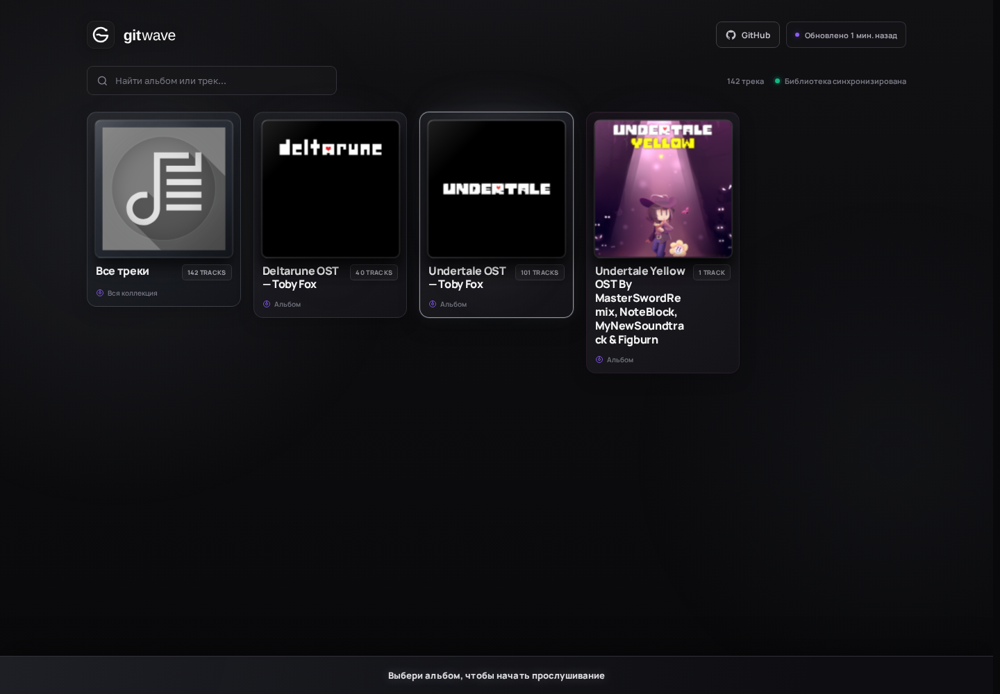

# gitwave

**Музыкальная библиотека, которая всегда под рукой.**

<a href="https://gamooda.github.io/gitwave/"><strong>Открыть плеер ↗</strong></a> · <a href="https://github.com/gamooda/gitwave">Исходный код</a>

  

## Всё для музыки

<table>
  <tr>
    <td width="50%">
      <h3>🔎 Быстрый поиск</h3>
      Находи альбомы и отдельные треки по названию.
    </td>
    <td width="50%">
      <h3>🎧 Общая коллекция</h3>
      Все композиции собраны в одном списке и разбиты по альбомам.
    </td>
  </tr>
  <tr>
    <td width="50%">
      <h3>🎛️ Удобный плеер</h3>
      Переключай треки, перемешивай и включай повтор.
    </td>
    <td width="50%">
      <h3>✨ Атмосфера альбома</h3>
      Цвета интерфейса подстраиваются под обложку.
    </td>
  </tr>
</table>

## Просто слушай

1. Выбери альбом или открой **«Все треки»**.
2. Нажми на композицию или кнопку **«Слушать»**.
3. Ищи нужную песню через строку поиска.
4. Управляй воспроизведением, громкостью и перемоткой в нижней панели.

  

## Управление

| Действие | Управление |
|:--|:--|
| Воспроизведение / пауза | **Пробел** |
| Перемотка назад / вперёд | **← / →** — по 5 секунд |
| Закрыть плейлист | **Esc** |
| Следующий или предыдущий трек | Кнопки плеера |
| Громкость, повтор и перемешивание | Нижняя панель |

[**Запустить GitWave ↗**](https://gamooda.github.io/gitwave/)

