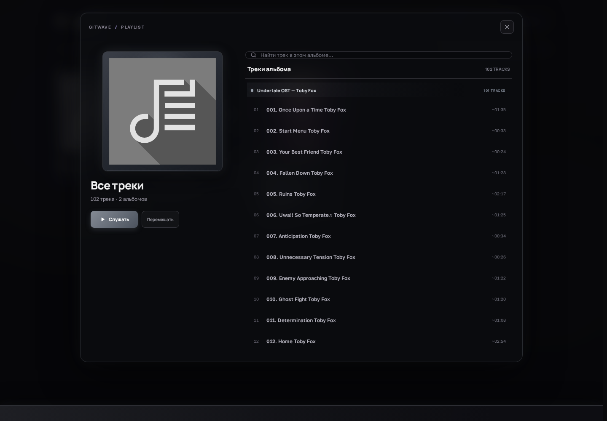

<div align="center">


### Персональная музыкальная библиотека в браузере

[Открыть GitWave](https://gamooda.github.io/gitwave/) · [Исходный код](https://github.com/gamooda/gitwave)


</div>

---

## Предпросмотр

<div align="center">

### Библиотека

<a href="docs/screenshots/library.png">
  
</a>

### Открытый альбом

<a href="docs/screenshots/playlist.png">
  
</a>

<sub>Скриншоты автоматически снимаются с опубликованной версии GitWave в Chromium.</sub>

</div>

## О GitWave

GitWave — минималистичный одностраничный музыкальный плеер. Он автоматически собирает библиотеку из папки `music/` в этом репозитории и превращает альбомы в интерактивную коллекцию.

## Возможности

- Автоматическое обнаружение альбомов и аудиофайлов в GitHub-репозитории.
- Обложки альбомов из `preview.png`, `.jpg` или `.webp`.
- Поиск по альбомам и трекам, включая поиск внутри открытого альбома.
- Отдельная библиотека «Все треки» с группировкой по альбомам.
- Воспроизведение MP3, OGG и WAV.
- Перемешивание, история переходов и три режима повтора.
- Регулировка громкости, mute, перемотка и горячие клавиши.
- Media Session API для мультимедийных клавиш и системного оверлея.
- Цветовая тема и фон, адаптирующиеся к обложке текущего альбома.
- Плавные переходы, анимированный эквалайзер и адаптивный интерфейс.

## Структура библиотеки

Добавляй музыку в репозиторий в таком формате:

```text
music/
├── Undertale/
│   ├── preview.png
│   ├── 001. Once Upon a Time.mp3
│   └── 002. Start Menu.mp3
└── Undertale Yellow/
    ├── preview.jpg
    ├── 001. Main Theme.ogg
    └── 002. Another Track.wav
```

Каждая подпапка внутри `music/` становится отдельным альбомом. Название альбома берётся из имени папки, а названия треков — из имён аудиофайлов.

Дополнительные изображения можно хранить рядом с музыкой:

- `preview.png`, `preview.jpg`, `preview.webp` — обложка альбома.
- `background.png` — дополнительный фон альбома.
- `logo.png` — логотип альбома.

Если необязательных изображений нет, плеер продолжает работать без них.

## Публикация

Проект рассчитан на GitHub Pages и не требует сборки:

1. Форкни или склонируй репозиторий.
2. Загрузи свои альбомы в папку `music/`.
3. В настройках репозитория открой **Settings → Pages**.
4. Выбери публикацию из ветки `main` и папки `/ (root)`.
5. После публикации открой адрес GitHub Pages.

## Технологии

- HTML, CSS и JavaScript без этапа сборки.
- GitHub REST API для чтения структуры репозитория.
- HTMLAudioElement и Media Session API.
- Canvas для анализа цветов и визуализации аудио.

---

<div align="center">

**gitwave** · Музыка — в твоём ритме.

</div>
